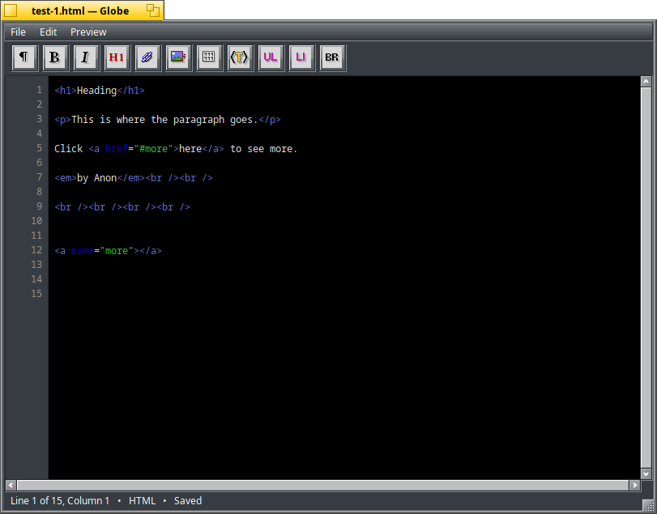

<p align="center">
  
</p>

<h1 align="center">Globe</h1>

<p align="center">
  
  
  
</p>

Globe is a Haiku-native editor for web files. This repository is a careful
modernisation of the original BeOS-era Globe editor, whose source is preserved
in [`Globe-Original`](Globe-Original/).

The current development version provides a small, dependable editor core:

- native Haiku document windows;
- new, open, save, and save-as workflows;
- multiple documents in separate windows;
- standard editing commands and shortcuts;
- protection against accidentally closing an unsaved document;
- line numbers that remain aligned while editing and scrolling;
- a live line, column, file-type, and modification-status display;
- theme-aware HTML, PHP, C/C++ header and source, and Haiku
  resource-definition syntax highlighting while editing;
- previewing in Haiku's preferred browser or the Tororu document viewer;
- an About window preserving Globe's original credits, artwork, and licence;
- and a compact HTML tag toolbar using the original artwork, with delayed tag
  completion after typing `<`.

## Building

Globe must be built on Haiku with the standard development tools installed:

```sh
make
```

Install it for the current user with:

```sh
make install
```

The default destination is `/boot/home/config/non-packaged/bin`. Override it
with `make install INSTALL_DIR=/another/path` when needed.

The portable syntax-highlighter and tag-template tests can be run on Haiku or
another system with a C++17 compiler:

```sh
make test
```

## Scripting with `hey`

Globe's application signature is `application/x-vnd.hGlobe`, keeping it
distinct from the historical application while the application name remains
`Globe`. Scripts therefore address the running application as `Globe`. Each
document receives a stable ID for the lifetime of the application. Documents
may also be addressed by their zero-based index.

```sh
hey Globe create Document with Path="/path/file.cpp" ReadOnly=true Presentation=true
hey Globe get ID of Document 0
hey Globe get Path of Document id="document-1"
hey Globe get ScrollMaximum of Document id="document-1"
hey Globe get ScrollPosition of Document id="document-1"
hey Globe set ScrollPosition of Document id="document-1" to 120
hey Globe delete Document id="document-1"
```

The standard name form, `Document "document-1"`, is also accepted anywhere an
ID specifier is shown above.

`ReadOnly=true` disables editing. `Presentation=true` hides the menu, tag
toolbar, and status display. A create command may omit `Path` to create an
untitled document, and its reply contains the new document ID in `result`.
Closing uses `delete`, the standard `hey` verb for `B_DELETE_PROPERTY`; the
window still follows Globe's normal unsaved-changes safeguard.

## Roadmap

Development is proceeding in small, testable milestones:

- [x] Add line numbers and a status bar showing the current line, column, file
  type, and modification state.
- [x] Add HTML, PHP, C/C++, and Haiku resource-definition syntax highlighting.
- [x] Add Preview commands for Haiku's preferred browser and Tororu.
- [x] Port the original tag toolbar and tag-completion menu.
- [ ] **Priority:** Add configurable syntax colours and editor display
  preferences, including font, size, word wrap, and line-number visibility.
- [x] Add the initial Haiku scripting suite for document creation, stable IDs,
  paths, read-only and presentation modes, scrolling, and closing.
- [ ] **Priority:** Expand `hey` scripting to cover selection, saving, and
  preview operations.
- [ ] Add session restoration and the original application icon and resources.
- [ ] Package Globe as an `.hpkg`.

## Project layout

- `src/` contains the modern Haiku application.
- `Globe-Original/` is the historical source used as the behavioural and
  design reference. Changes for the modern application should be made in
  `src/`, leaving that reference tree intact.

